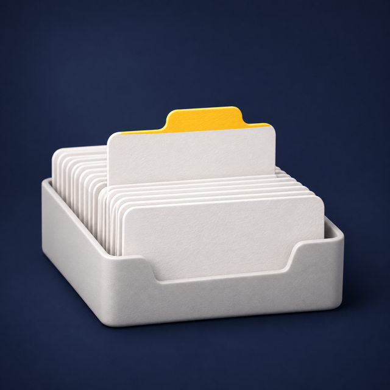
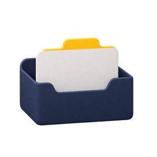
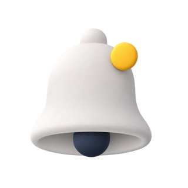
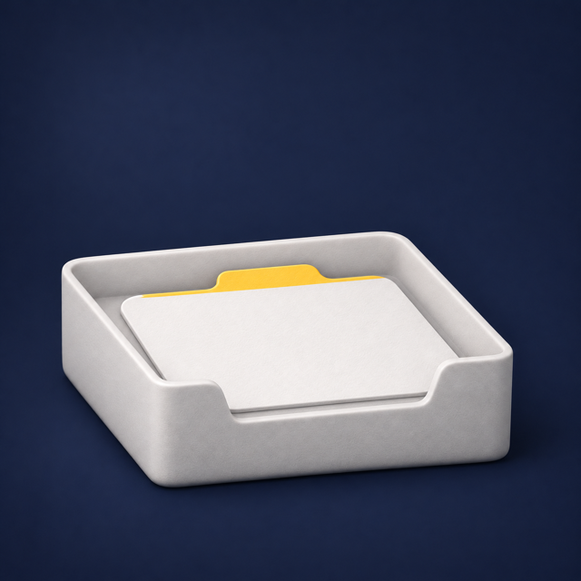

# Codex Imagegen

### Claude Codeで、画像を作り、選び、仕上げる。

**画像の生成中も、コーディングを続けられます。** 利用中のCodexサブスクリプションで動作し、画像APIキーや別途API料金は不要です。

[English](README.md) · [한국어](README.ko.md) · **日本語** · [简体中文](README.zh-CN.md)

```bash
npx skills add https://github.com/JunSeo99/claude-skill-codex-imagegen --skill codex-imagegen
```

> 「メモアプリのオンボーディング画像、方向性を3つ見せて」

| A · インクネイビーのマット3D | B · 2色リソグラフ | C · アプリコット地のペーパークラフト |
|:---:|:---:|:---:|
|  |  |  |

> 「Aにする。アプリ内アイコンと空の状態も揃えて」

| 新規メモ | フォルダ | 検索 | リマインダー | 空の状態 |
|:---:|:---:|:---:|:---:|:---:|
|  |  |  |  |  |

一行の依頼ごとにClaudeがアートディレクション（明度差、3色の役割、ひとつの主役）を含む指示を書き、Aのスタイルを全アセットに固定し、見せる前に透過と一貫性を確認しました。付属ランチャーで実際に生成した画像です。[指示・プラン・検証記録](docs/validation.md)を公開しています。画像モデルはCodexのサーバーが選ぶため、特定のバージョンとは表示していません。

## 自然な言葉で依頼

| 目的 | 依頼の例 |
|---|---|
| すぐに生成 | 「このページに合うヒーロー画像を作って」 |
| 方向性を相談 | 「まだ決まっていないので、短く質問して」 |
| 候補を比較 | 「違う方向性で3案見せて」 |
| 部分編集 | 「2番を使って、背景だけ変えて」 |
| 透過画像 | 「商品を透明なPNGにして」 |
| スタイルを揃える | 「アプリのトーンで設定アイコンを作って、残りのアイコンも同じスタイルで」 |
| 並列作業 | 「画像を生成している間にUIを仕上げて」 |

明確な依頼にはすぐ着手します。必要なときだけ質問し、候補は別々の画像として保存します。編集は元画像を残し、変更したい部分と保つ部分を区別します。

## セットアップ

macOS/Linux、Python 3.9+、Claude Code、ログイン済みのCodex CLI 0.164.0+が必要です。

```bash
npm install -g @openai/codex
codex login
```

上のコマンドでスキルをインストールしたら、新しいClaude Codeセッションで依頼してください。`DESIGN.md`や参考画像を指定すると、見た目を揃えられます。手動なら`skill/`を`~/.claude/skills/codex-imagegen/`へコピーします。Skills CLIの更新は`npx skills update`です。

## バックグラウンド生成

分離したPythonワーカーがCodexの応答を待ち、Claudeにはジョブ情報をすぐ返します。同時実行は標準2件、最大4件。PNG、比較用HTML、状態、ログをローカル保存します。状態確認はCodexを呼びません。失敗後に確認して再開すると、完了済み画像は再生成しません。PCは起動している必要があり、ホストによっては専用のバックグラウンド実行機能が必要です。

```bash
python3 skill/scripts/image_project.py --prompt-file output/imagegen/hero/hero.md --out-dir output/imagegen/hero/run-1 --background
python3 skill/scripts/image_project.py --out-dir output/imagegen/hero/run-1 --status
```

複数案は[JSONプラン](tests/prompts/demo/plan.json)を`--plan`で指定します。

## 小さなコンテキスト、明確な対応範囲

Claudeが企画と確認を担当し、Codexには完成した短い指示だけを渡します。中継モデルは標準で`gpt-6-luna`、推論は`none`。一般的なコーディング指示とスキル一覧を省きます。[検証](docs/validation.md)で確認したコンテキスト削減は、総トークンや料金の削減率を保証するものではありません。

OpenAIのAPIにはGPT Image 2.5と、2026年11月の[Images 2.6](https://openai.com/index/introducing-images-2-6/)があり、それぞれFlare（速度）とSunburst（精細さ・精密な編集）に分かれます。OpenAIは2.6がCodexでも使えるとしています。ただし、**このサブスクリプション経路では画像モデルを選ぶことも確認することもできません**。サーバーがモデルを決め、応答やファイルのメタデータにも表示されません。`--model`はテキスト中継モデルの設定です。2.6のAPI専用機能（complexity、マークアップ編集、SVG、GIF）は使えません。有料APIへ切り替える経路はありません。

透過PNGは実際のアルファ値を検証します。文字、形状、意図しない変更はClaudeが画像を見て確認します。生成編集にピクセル単位の保持保証はありません。

[詳細（英語）](README.md) · [変更履歴](CHANGELOG.md) · [セキュリティ](SECURITY.md) · [MIT](LICENSE)

役に立ったら、Starで保存して今後のリリースもチェックしてください。Anthropic/OpenAIとは独立したプロジェクトです。
