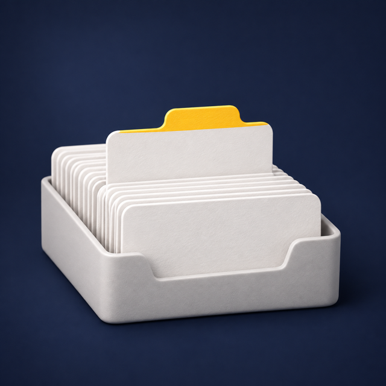
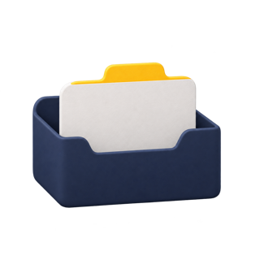
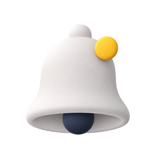
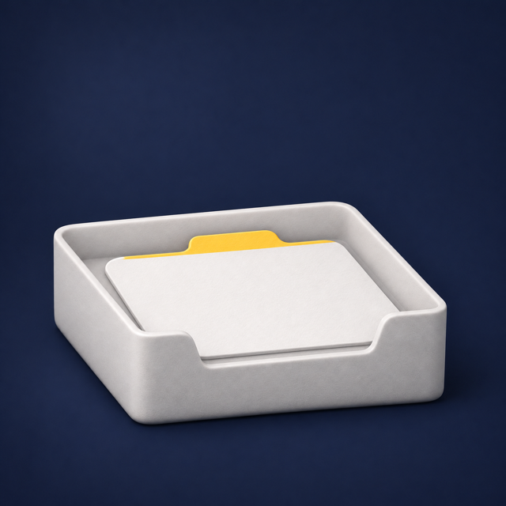

<div align="center">

# Codex Imagegen

### Beautiful images. Right inside Claude Code.

Describe it. Compare directions. Refine your favorite. **Keep coding while images render.**

[](https://skills.sh/JunSeo99/claude-skill-codex-imagegen/codex-imagegen) [](https://github.com/JunSeo99/claude-skill-codex-imagegen/actions) [](LICENSE)

**English** · [한국어](README.ko.md) · [日本語](README.ja.md) · [简体中文](README.zh-CN.md)

</div>

A Claude Code skill for turning a rough idea into reviewed image files using your **existing Codex subscription**. No image API key. No separate API bill. No new prompt language to learn.

```bash
npx skills add https://github.com/JunSeo99/claude-skill-codex-imagegen --skill codex-imagegen

# Or install it as a Claude Code plugin (updates through the plugin manager):
claude plugin marketplace add JunSeo99/claude-skill-codex-imagegen
claude plugin install codex-imagegen@codex-imagegen

# From a clone, check Codex readiness (no model call):
python3 skill/scripts/codex_status.py
```

> “Show me three directions for my notes app's onboarding illustration.”

| A · Ink navy, matte 3D | B · Two-color risograph | C · Cut paper on apricot |
|:---:|:---:|:---:|
|  |  |  |

> “A it is. Make the in-app icons and the empty state match.”

| New note | Folder | Search | Reminder | Empty state |
|:---:|:---:|:---:|:---:|:---:|
|  |  |  |  |  |

For each one-line request, Claude wrote an art-directed brief (value contrast, three-color palette roles, one focal subject), locked direction A's style for every asset, and checked transparency and consistency before showing anything. Actual outputs through the bundled Codex launcher, not hand-built mockups. [Briefs, plans, and verification](docs/validation.md). Codex picks the image model on its server, so these are not labeled with a GPT Image version.

[Get started](#get-started) · [What you can ask](#what-you-can-ask) · [Background generation](#background-generation) · [How it stays lean](#how-it-stays-lean) · [Image models](#image-models)

## What you can ask

| You say | The skill does |
|---|---|
| “Make a hero image for this page.” | Uses the page's style and layout; creates one image. |
| “I'm not sure what I want. Interview me.” | Asks a few useful questions before spending generation quota. |
| “Show me three different directions.” | Makes separate images and a local comparison gallery. |
| “Use option 2. Change only the background.” | Edits the chosen image, preserves the original, checks for drift. |
| “Cut this product photo out onto a transparent background.” | Requests genuine alpha, checks decoded PNG pixels, and compares labels and detail with the source. |
| “Make a settings icon in our app's style, then the rest of the set.” | Settles the style on one sample, then repeats a style lock for every asset. |
| “Generate these while you finish the UI.” | Starts background workers; Claude continues independent work. |

No mandatory interview for a clear request. No extra variations when you asked for one. No automatic polishing loop after an image already works.

## Get started

You need **Claude Code**, **Python 3.9+**, and **Codex CLI 0.164.0+** on macOS, Linux, or Windows, with an active Codex login.

```bash
# If Codex is not installed yet:
npm install -g @openai/codex
codex login

# Install this skill:
npx skills add https://github.com/JunSeo99/claude-skill-codex-imagegen --skill codex-imagegen
```

Open a new Claude Code session and ask:

> “Create a warm editorial hero image for this landing page. Leave room for the headline on the left. Save the final image to assets/hero.png.”

Already have a design system? Point Claude at your `DESIGN.md` or attach a reference image. Ask in English, Korean, Japanese, or your preferred language.

<details>
<summary>Manual installation and updates</summary>

Clone the repository and copy the skill into `~/.claude/skills/codex-imagegen/`, or symlink `skill/` there for development. The installable folder is **skill/**, not the repository root.

A reproducible [codex-imagegen.skill](dist/codex-imagegen.skill) archive is also available; unzip it into `~/.claude/skills/`.

To update a Skills CLI installation, run `npx skills update`. For a development clone, pull the latest release. Restart Claude Code if it still shows the previous instructions.

</details>

## Background generation

Image calls themselves wait for Codex. **The host no longer has to.** A detached Python worker owns that wait, while Claude gets a job handle immediately. Multiple candidates run with bounded concurrency: two at a time by default, up to four.

```text
Claude: understand → write brief → start job ───→ continue coding → inspect results
                                     ├─ image A ─┐
                                     └─ image B ─┴─→ PNGs + gallery + manifest
```

Claude normally handles the commands. For scripting from a clone:

```bash
python3 skill/scripts/image_project.py \
  --prompt-file output/imagegen/hero/hero.md --out-dir output/imagegen/hero/run-1 --background

python3 skill/scripts/image_project.py --out-dir output/imagegen/hero/run-1 --status
```

For multiple directions, supply a [small JSON plan](tests/prompts/demo/plan.json) with `--plan` and optionally `--workers 2`. Use `--dry-run` to validate without generating. `--model` changes the text relay for every job; the default `gpt-6-luna` is recommended.

Outputs include separate PNGs, `index.html`, `manifest.json`, and `worker.log`. Successful candidates survive failures. After inspecting the error, `--resume` verifies and skips completed images. It never restarts the whole set automatically. Keep the machine awake; background jobs are local processes, not cloud queues. Hosts that terminate detached processes may require their own background-task facility.

## How it stays lean

**Claude makes the decisions. Codex receives the finished brief.**

- A compact skill entrypoint loads only the reference needed for the current task.
- The relay uses `gpt-6-luna` with reasoning `none` by default.
- General coding instructions are replaced by a short image-only relay instruction. The skills catalog and unrelated capabilities are disabled for that subprocess.
- Interviews, art direction, quality review, galleries, and status checks do not start another Codex conversation.
- A rejected relay does not silently upgrade to a heavier model. Completed images are not regenerated on resume.

On codex-cli 0.164.0, dropping the `$imagegen` mention and Codex's permission and collaboration notes cut relay input from about **10,800 to 5,900 tokens per request**. Sampled runs still reported 8,500–37,000 relay tokens (13,124 on 0.166.0 in November 2026), and image generation draws on your Codex allowance separately. [Measurement details](docs/validation.md).

## Image models

OpenAI's API offers GPT Image 2.5 and, since November 2026, [Images 2.6](https://openai.com/index/introducing-images-2-6/), each as Flare (speed) and Sunburst (detail and precise edits). OpenAI says 2.6 is available in Codex too. The skill's prompting and review guidance follows the [official image guidance](https://developers.openai.com/api/docs/guides/image-generation).

**This subscription path cannot choose or confirm the image model.** Codex sends a fixed label and its server decides; responses and file metadata do not say which model ran. `--model` chooses the lightweight text relay, not the image model. API-only 2.6 features (complexity, markup edits, SVG, GIF) are not available here. We do not substitute a separately billed API, invent a model selector, or label an output with a model version. [Research and capability boundaries](docs/model-research.md).

## Quality you can inspect

Generation is only one step. Claude inspects composition, exact text, product geometry, unwanted changes, and edges before delivery. Transparent cutouts must pass the bundled pixel validator:

```bash
python3 skill/scripts/verify_png_alpha.py --require-transparent-corners image.png
```

Keep original files. Export proportionally to the requested size; no stretching and no “native 4K” claim for an upscale. Generative edits can drift, text can need correction, and account limits still apply. The older 0.153.2 size/alpha observations are retained as dated evidence, not universal model limits.

The Codex child uses a read-only sandbox, isolated configuration, an environment allowlist, and validated output paths. Background workers only orchestrate this same launcher. [Security](SECURITY.md).

## Built for reuse

The skill follows the folder-based Agent Skills format with a concise intent description, relative references, and Python-standard-library scripts. The README is for people; runtime instructions live in [skill/SKILL.md](skill/SKILL.md).

| Resource | Purpose |
|---|---|
| [Skill entrypoint](skill/SKILL.md) | Intent routing and the minimal generation workflow |
| [Creative directions](skill/references/directions.md) | Separate candidates, selection, and resumable jobs |
| [Editing guide](skill/references/editing.md) | Reference roles, preservation, transparent edits |
| [CLI reference](skill/references/cli-reference.md) | Options, capability boundaries, troubleshooting |
| [Changelog](CHANGELOG.md) | Versioned behavior changes |
| [Validation](docs/validation.md) | Tests, live observations, and limitations |

## Contribute a result

Found a prompt that works especially well, or an edit that drifts? Open an issue with the prompt, expected result, CLI version, and an image you have permission to share. Remove private material first. Contributions that improve reproducible image quality are welcome.

If this earns a place in your Claude Code workflow, **star the repository** to find it again and follow releases.

[MIT license](LICENSE). Independent project; not affiliated with Anthropic or OpenAI.
