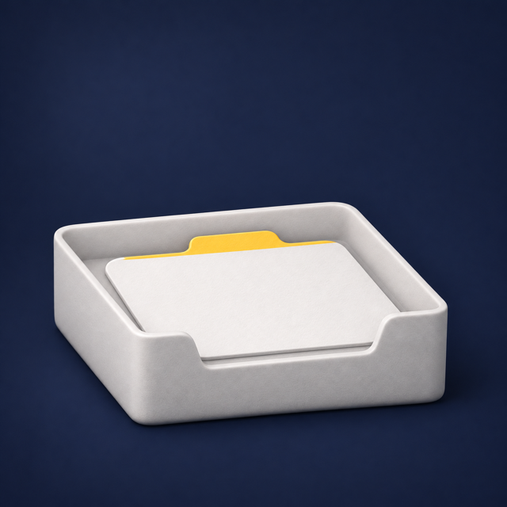

# Codex Imagegen

### 在 Claude Code 中生成图片、比较方案、修改细节。

**图片在后台生成，代码继续写。** 使用现有的 Codex 订阅，无需图片 API 密钥，也没有额外的 API 账单。

[English](README.md) · [한국어](README.ko.md) · [日本語](README.ja.md) · **简体中文**

```bash
npx skills add https://github.com/JunSeo99/claude-skill-codex-imagegen --skill codex-imagegen
```

> “给我的笔记应用的引导页插画出三个方向。”

| A · 墨蓝哑光 3D | B · 双色孔版印刷 | C · 杏色底纸艺 |
|:---:|:---:|:---:|
|  |  |  |

> “就用 A。应用内图标和空状态也保持同一风格。”

| 新建笔记 | 文件夹 | 搜索 | 提醒 | 空状态 |
|:---:|:---:|:---:|:---:|:---:|
|  |  |  |  |  |

每个一句话需求，Claude 都写成带有艺术指导（明暗对比、三色分工、单一主体）的图片指令，把 A 的风格锁定到所有素材，并在展示前检查透明度和一致性。这些图片由仓库自带的启动器实际生成。[指令、计划和验证记录](docs/validation.md)均可查看。图片模型由 Codex 服务器选择，因此不标注具体版本。

## 用自然语言开始

| 目标 | 示例 |
|---|---|
| 直接生成 | “为这个页面生成一张主视觉。” |
| 明确方向 | “我还没想好，先简短地问我几个问题。” |
| 比较方案 | “给我三个明显不同的方向。” |
| 局部修改 | “选第二张，只改背景。” |
| 透明图片 | “把商品做成透明 PNG。” |
| 统一风格的一套素材 | “按应用的风格做一个设置图标，其余图标也保持同一风格。” |
| 并行工作 | “图片生成期间继续完成 UI。” |

需求清晰就直接执行，只在需要时访谈。每个方案保存为独立图片；修改时保留原图，并明确哪些内容改变、哪些需要保持。

## 安装要求

macOS/Linux/Windows、Python 3.9+、Claude Code，以及已登录的 Codex CLI 0.164.0+。

```bash
npm install -g @openai/codex
codex login
```

安装技能后打开新的 Claude Code 会话即可。可以指定 `DESIGN.md`、参考图片和保存路径。手动安装时，将 `skill/` 复制到 `~/.claude/skills/codex-imagegen/`。通过 Skills CLI 安装后可用 `npx skills update` 更新。

## 后台与并行生成

独立的 Python 工作进程负责等待 Codex，立即向 Claude 返回任务信息。默认同时运行两个生成任务，最多四个。PNG、对比用 HTML、状态文件和日志都保存在本地。状态查询不会调用 Codex。失败后检查错误再恢复，已经完成的图片不会重新生成。电脑需要保持运行；部分宿主环境可能需要自己的后台任务机制。

```bash
python3 skill/scripts/image_project.py --prompt-file output/imagegen/hero/hero.md --out-dir output/imagegen/hero/run-1 --background
python3 skill/scripts/image_project.py --out-dir output/imagegen/hero/run-1 --status
```

多个方案可用 `--plan` 传入[JSON 计划](tests/prompts/demo/plan.json)。

## 精简上下文，明确能力边界

Claude 负责访谈、构思与检查；Codex 只接收完成后的简短图片指令。默认中继模型为 `gpt-6-luna`，推理设为 `none`，省去通用编码指令和技能目录。[验证记录](docs/validation.md)中的上下文缩减不代表总 token 或成本同比例下降。

OpenAI API 提供 GPT Image 2.5 和 2026 年 11 月发布的 [Images 2.6](https://openai.com/index/introducing-images-2-6/)，各分为 Flare（速度）和 Sunburst（细节与精细编辑）。OpenAI 表示 2.6 也可在 Codex 中使用。但**当前订阅路径既不能选择也无法确认图片模型**：由服务器决定，响应和文件元数据中也不显示。`--model` 设置的是文本中继模型，不是图片模型。2.6 的 API 专属功能（complexity、标注编辑、SVG、GIF）在这里不可用。没有切换到付费图片 API 的路径。

透明 PNG 会检查真实的 alpha 像素。Claude 会查看文字、形状和非预期变化；生成式编辑不保证其他区域像素完全不变。

[完整文档（英文）](README.md) · [更新日志](CHANGELOG.md) · [安全说明](SECURITY.md) · [MIT](LICENSE)

如果这个技能对你有用，欢迎 Star 保存并关注后续版本。本项目独立于 Anthropic 和 OpenAI。
